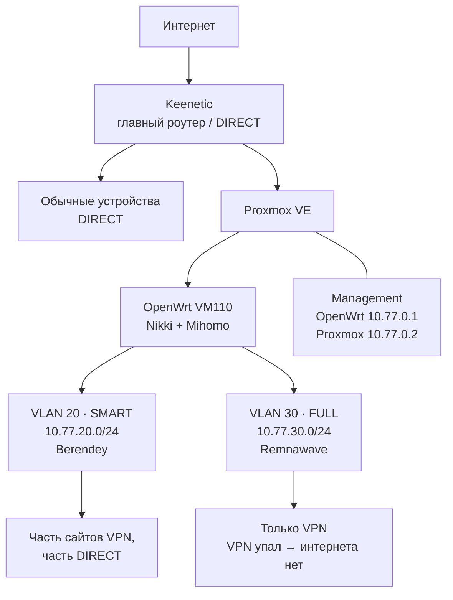

# Домашний VPN-шлюз: Proxmox + OpenWrt + Nikki/Mihomo

Пошаговое руководство по повторению домашней схемы с тремя режимами сети:

| Режим | Куда идёт трафик | Для чего |
|---|---|---|
| DIRECT | напрямую через Keenetic | обычный домашний интернет |
| SMART (VLAN 20) | по правилам Berendey: часть напрямую, часть через прокси | «VPN только там, где надо» |
| FULL (VLAN 30) | только через Remnawave | весь трафик через VPN; при падении VPN интернета нет |

DIRECT не зависит от сервера: если Proxmox выключен, Keenetic продолжает раздавать обычный интернет.

> Важно: это не экспорт готовых конфигов. В нём намеренно нет подписок, ключей, паролей, API-secret и угаданных номеров портов. Команды и шаблоны безопасно заполнять своими значениями.

## Что подтверждено для исходного HomeLab

- Proxmox VE, OpenWrt в VM с ID `110`, 2 vCPU и 2 GB RAM.
- Keenetic — основной роутер и DIRECT; сеть WAN OpenWrt — `192.168.1.250/24`, шлюз `192.168.1.1`.
- Management: OpenWrt `10.77.0.1/24`, Proxmox `10.77.0.2/24`, без default gateway на management-интерфейсе Proxmox.
- SMART: `10.77.20.0/24`, шлюз `10.77.20.1`, Berendey через Nikki/Mihomo.
- FULL: `10.77.30.0/24`, шлюз `10.77.30.1`, Remnawave через Nikki/Mihomo, политика fail-closed.
- Для FULL правило по источнику `10.77.30.0/24` должно стоять до остальных правил Mihomo.
- В исходной схеме TCP обрабатывался redirect, UDP — TUN. Не меняйте это без отдельного теста.

## Что надо проверить до применения

Точные версии OpenWrt/Nikki/Mihomo, имя образа, физический порт/trunk, имена интерфейсов в VM, конкретные firewall-правила Nikki, DNS-провайдеры и форматы подписок в доступных материалах не подтверждены. Поэтому они помечены `ПРОВЕРИТЬ` и даны как шаблоны, а не как «рабочий конфиг».

## Как читать руководство

1. [Подготовьте значения](docs/01-подготовка.md).
2. [Соберите сети Proxmox](docs/02-proxmox-и-vlan.md).
3. [Настройте OpenWrt и firewall](docs/03-openwrt-и-firewall.md).
4. [Подключите Nikki/Mihomo, Berendey, Remnawave и DNS](docs/04-nikki-mihomo-dns.md).
5. [Проверьте fail-closed и подготовьте откат](docs/05-проверка-и-откат.md).
6. Для сопровождения настройки через Cursor используйте [готовый промт](docs/CURSOR-PROMPT.md).
7. Если это ваш первый раз с Proxmox/VLAN, идите по [супер-подробному сценарию](docs/07-пошагово-для-новичка.md).

Шаблоны лежат в [`templates/`](templates/). Они не содержат секретов и не применяются автоматически.

## Схема



### Кто за что отвечает

| Компонент | Не надо в нём настраивать | Что он делает |
|---|---|---|
| Keenetic | VPN-правила SMART/FULL | даёт обычный интернет и DIRECT |
| Proxmox | маршрутизацию клиентов | запускает VM и передаёт VLAN |
| OpenWrt | доступ к интернету DIRECT | DHCP, firewall и шлюз SMART/FULL |
| Nikki/Mihomo | VLAN и физические порты | правила прокси/VPN, DNS и прозрачный перехват |

## Быстрый контроль перед публикацией

```powershell
git status
git grep -nEi 'subscription|token|secret|password|private.?key|ss://' -- ':!docs/00-безопасность.md'
```

Вторая команда не должна показать реальные данные. Совпадения с предупреждениями и плейсхолдерами просмотритe вручную.

См. также: [правила безопасности](docs/00-безопасность.md) и [публикация на GitHub](docs/06-публикация-на-github.md).
